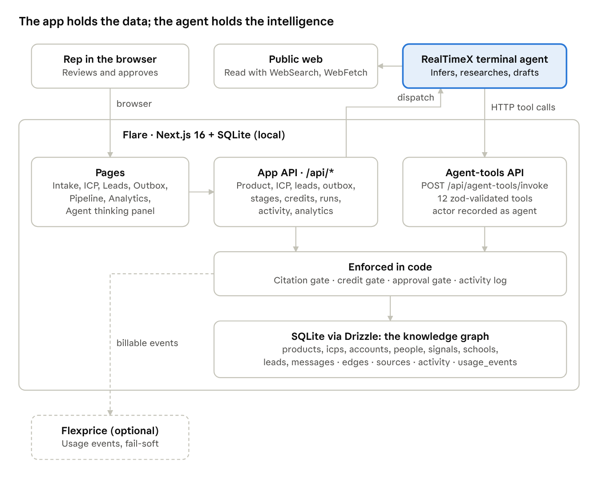

# Flare: System Design & Architecture

Nov 24, 2026 · @Jay

## Overview

Flare is an AI go-to-market engine: a founder describes a product in plain language, and Flare returns cited leads, human-approved outreach and a tracked pipeline. It was built at HackwithBay 4.0 on 2026-11-24 by the RealTimeX team.

**The app holds the data; the agent holds the intelligence.** Flare itself has no LLM API key. It is a local Next.js app with SQLite and a stable agent-tools API. ICP inference, web discovery, enrichment and copywriting run in a RealTimeX terminal agent that calls those tools over HTTP.

The flow has five stages, each a page in the app:

1. **Intake:** the founder describes the product (name, description, pricing, current customers) and clicks Run GTM agent.
2. **ICP:** the agent infers industries, size bands, personas and buying triggers, each with a 0–1 confidence, plus expansion segments with sources.
3. **Leads:** accounts and decision-makers, each fact backed by a public source, scored 0–100 and tiered A, B or C.
4. **Outbox:** signal-personalized drafts with A/B variants. Nothing is sent until a human approves.
5. **Pipeline:** Matched → Contacted → Replied → Meeting Booked → Closed Won / Closed Lost, with agent vs rep attribution on every move.

**Design goals:**

- **Every fact is cited.** No source, no lead: uncited records are quarantined by the app, not just discouraged by the prompt.
- **A human approves every outbound message.** The agent drafts; the rep decides.
- **Every step is visible.** Each tool call lands in an activity log that the Agent thinking panel shows live, as a list or a node graph.
- **Usage is metered.** Billable events cost credits and are sent to Flexprice when a key is set.

## System architecture



The agent and the rep reach the same SQLite store through two APIs, and both pass the same enforcement layer, so no path skips the citation, credit or approval gates. Dashed parts are optional: Flexprice only receives events when a key is set.

## Graph ontology

The knowledge graph is a property graph stored in SQLite: typed entity tables are the nodes, one `edges` table holds every typed relationship, and one `sources` table attaches citations to any node. Every node also carries a `status` of `active` or `quarantine`.

### Node types

| Entity | Table | Key fields | Cited? |
| --- | --- | --- | --- |
| product | `products` | name, website, description, pricing, customers\[\] | No (founder input) |
| icp | `icps` | industries\[\], sizeBands\[\], personas\[\], triggers\[\], confidence per field (0–1), expansions\[\] with rationale + sources | Expansions carry inline sources |
| account | `accounts` | name, domain, industry, size, hq | Yes, else quarantined |
| person | `people` | name, title, accountId, linkedinUrl, email, emailStatus (`unverified` / `pattern` / `verified`) | Yes, else quarantined |
| signal | `signals` | accountId, kind (`funding`, `hiring`, `exec_hire`, `tech_change`, `expansion`, `product_launch`, `news`, `other`), summary, date | Yes, else quarantined |
| school | `schools` | name, domain | Via the edge's source |
| lead | `leads` | personId × productId, fitScore 0–100, tier A/B/C, rationale, stage, ownerKind | Inherits from person |
| message | `messages` | leadId, channel (email / linkedin), step 1–3, variant A/B, subject, body, signalsUsed\[\], status | Signals used must be active |

### Edge types

Edges are directed rows `(fromType, fromId) → (toType, toId)` with a `type` and optional JSON `meta`, deduplicated on insert.

| Edge | From → To | Written by | Used for |
| --- | --- | --- | --- |
| `works_at` | person → account | `add_person` (automatic) | Warm paths |
| `previously_employed_at` | person → account | `add_edge` | Warm paths |
| `studied_at` | person → school | `add_edge` | Warm paths |
| `competes_with` | account → account | `add_edge` | Context for copy |
| `matched_to` | person → product | `upsert_lead` (meta: fitScore) | Lead provenance |
| `contacted_via` | lead / person → message | Outreach | Attribution |
| `replied_to` | person → message | Outreach | Attribution |

### Provenance and quarantine

- **Sources:** each row in `sources` is `(entityType, entityId, url, quote, retrievedAt)`. Only `http(s)` URLs are accepted.
- **The citation gate:** `add_account`, `add_person` and `add_signal` require at least one source. A call without one still saves the record, but as `quarantine`, and returns a warning to the agent.
- **What quarantine blocks:** quarantined records are hidden from leads, excluded from graph paths, refused as an outreach signal, and counted in the UI ("2 quarantined").
- **Promotion:** calling the same tool again with a source promotes the record to `active`. Records are deduplicated (accounts by domain then name, people by LinkedIn URL then name + account), so a retry updates instead of duplicating.
- **Email truth:** `verified` only when a public page states that exact address; `pattern` when built from the company's published email pattern, with that page cited. No third-party enrichment or verifier APIs.

## Query logic

All queries run in-process against SQLite through Drizzle. There are four query paths: warm-intro graph traversal, lead listing and scoring, pipeline analytics, and the activity feed.

### Warm-intro paths (`query_graph`)

A recursive CTE walks employer and school edges in both directions from a starting person and returns paths that end at another person. 2 hops = a shared employer or school (A → Org ← B); 4 hops = a colleague of a colleague.

```sql
WITH RECURSIVE
  e(a, b, etype) AS (            -- warm edges, both directions
    SELECT from_type||':'||from_id, to_type||':'||to_id, type FROM edges
     WHERE type IN ('works_at','previously_employed_at','studied_at')
    UNION ALL
    SELECT to_type||':'||to_id, from_type||':'||from_id, type FROM edges
     WHERE type IN ('works_at','previously_employed_at','studied_at')),
  blocked(k) AS (                -- quarantined people and accounts
    SELECT 'person:'||id FROM people WHERE status='quarantine'
    UNION ALL SELECT 'account:'||id FROM accounts WHERE status='quarantine'),
  walk(node, path, etypes, hops) AS (
    SELECT :start, ','||:start||',', ',', 0
    UNION ALL
    SELECT e.b, walk.path||e.b||',', walk.etypes||e.etype||',', walk.hops+1
      FROM walk JOIN e ON e.a = walk.node
     WHERE walk.hops < :maxHops
       AND instr(walk.path, ','||e.b||',') = 0   -- no cycles
       AND e.b NOT IN (SELECT k FROM blocked))
SELECT path, etypes, hops FROM walk
 WHERE hops > 0 AND node LIKE 'person:%'
   AND (:target IS NULL OR node = :target)
 ORDER BY hops, path LIMIT :limit;
```

- **Bounds:** `maxHops` is clamped to 2–4, `limit` to 1–100 (default 20).
- **Safety:** the visited-path check prevents cycles; the `blocked` set keeps quarantined nodes out of every path; a quarantined starting person is refused with `citation_required`.
- **Output:** each path is labeled from the entity tables and returned with a human summary, e.g. "Dana Okafor → (works\_at) → Northwind → (previously\_employed\_at) → Luis Ortega".
- **Cost:** each call meters one `graph_query` credit.

### Lead scoring and listing

- **Fit score:** the agent sets `fitScore` (0–100) per person × product in `upsert_lead`, with a rationale that names the ICP fields and the signals matched. Buying intent enters through those cited signals.
- **Tier:** derived from the score unless the agent passes one: **A at 75 or more, B at 50 or more, otherwise C.**
- **Guard:** a quarantined person cannot become a lead (`citation_required`).
- **Listing (`list_leads`, Leads page):** leads join person and account, ordered by `fitScore` descending then id, with each account's active signals (newest first) and every source URL attached. Quarantined people never appear.

### Pipeline analytics

- **Highest stage reached:** for each lead, the furthest stage it ever held, taken from its current stage and every `move_stage` entry in the activity log. A lead that replied and then closed lost still counts as replied.
- **Funnel:** counts per stage, plus reply rate (replied ÷ contacted) and win rate (won ÷ leads).
- **Breakdowns:** conversion by industry and by tier; A/B variants compared on drafted, approved, rejected and sent counts and reply rate.
- **Attribution:** stage moves counted by actor (`agent` vs `rep`), plus rep approvals.

### Activity feed

`GET /api/activity` returns the log newest first. Clients pass `afterId` or `since` to fetch only newer rows; `limit` is clamped to 1–500. The Agent thinking panel polls every 2 seconds.

## Agent reasoning loop

The agent runs one unattended pass over nine phases, defined in `agent/SKILL.md`, and every decision it makes is checked by the app's tools rather than trusted. A run targets 5–10 accounts and 5–15 leads, then stops and summarizes.

### Phases

1. **Read state:** `get_product` returns the product, any saved ICP, lead count, quarantine counts and the credit balance.
2. **Infer the ICP:** research the product's site, pricing, customers and competitors, then `save_icp` with industries, size bands, personas and triggers. Each field gets a 0–1 confidence, lower when guessing, plus 2–3 cited expansion segments.
3. **Find accounts:** 5–10 real companies that fit, each saved with `add_account` and its sources.
4. **Find signals:** 1–3 recent buying signals per account (funding, hiring, exec hire, tech change, expansion, launch, news) via `add_signal`, with a date and source.
5. **Find people:** 1–2 people per good account matching the personas, via `add_person`. Past employers and schools go in with `add_edge`, each cited.
6. **Score:** `upsert_lead` per person, with a 0–100 fit score and a rationale naming the ICP fields and signals matched.
7. **Map warm paths:** `query_graph` for the top leads. Any shared employer or school path goes into the rationale or the message.
8. **Draft outreach:** `list_leads`, then `draft_message` for each A and B lead: a step-1 email of at most 120 words that cites at least one signal in `signalsUsed`. A-tier leads also get a variant B with a different hook.
9. **Stop and summarize:** accounts, people, leads by tier, drafts awaiting approval, and anything quarantined.

### The per-call loop

Inside each phase the agent repeats the same small cycle:

- **Research:** read a public page with WebSearch or WebFetch.
- **Act:** save the fact right away with one Flare tool call, sources attached. No batching research first.
- **Check:** read the response. `ok:false` carries a `code`; `ok:true` can still carry `warnings` (e.g. "record quarantined, no source"). The agent fixes what the warning points at, usually by re-calling with a source.
- **Narrate:** `log_note` before each phase and at every judgment call, at least every minute or two, so the rep sees the reasoning in Agent thinking.

### Stop conditions

- `insufficient_credits` (HTTP 402): stop enrichment, log that credits ran out, ask the rep to top up. No retry loop.
- `approval_required` (HTTP 409): the agent tried to move a lead past Matched before a rep approved a message. It leaves the lead and continues.
- The run reaches its targets: it summarizes and ends.

### Unattended by design

The run happens in a terminal no one may be watching, and a new kind of shell command can block it on a permission prompt. So the agent uses Bash only for the exact `curl …/api/agent-tools/invoke` pattern, reads pages with WebFetch instead of shell pipelines, and works alone without subagents.

## Human-in-the-loop and safety

The safety rules are enforced in code at the tool and API layer, so a prompt-injected or careless agent still cannot break them. The skill file repeats them, but the app does not rely on the agent obeying.

| Rule | Enforcement | Error the agent sees |
| --- | --- | --- |
| Every account, person and signal is cited | Saved as `quarantine` without an `http(s)` source; hidden from leads, paths and copy | Warning on save; `citation_required` (409) on later use |
| Only a rep approves outreach | `draft_message` always writes `draft`; only the Outbox API (`PATCH /api/messages/:id`, actor `rep`) sets `approved` / `rejected` | n/a: the agent has no approve tool |
| Approved and sent copy is locked | Re-drafting an approved or sent message fails; sent messages are immutable | `locked` (409) |
| Editing approved copy needs re-approval | A rep edit to an approved message sets it back to `draft` | n/a |
| No pipeline moves without approval | The agent may move a lead past Matched (except to Closed Lost) only once one of its messages is approved or sent | `approval_required` (409) |
| Spending stops at zero | Credits are decremented atomically (`balance >= cost` in the same UPDATE); nothing is spent when it fails | `insufficient_credits` (402) |
| Every action is attributed | Each tool call and rep action is logged with `actorKind` = `agent` or `rep` | n/a |

### The approval flow

1. The agent drafts a message tied to a lead and to the cited signals it used.
2. The draft appears in the Outbox with its A/B variant, step and signals.
3. The rep edits, approves or rejects it. Approve records `decidedBy` and `decidedAt`, meters one `outreach_sent` credit, and logs `message.approve`.
4. Only then can the lead move to Contacted, by the agent or the rep.

### Data boundaries

- **No third-party enrichment:** no Hunter, Apollo, Clearbit, ZoomInfo or email-verifier APIs. Discovery comes only from public web research.
- **Public sources only:** company sites, press, news, job posts and public profiles. Personal data stops at name, title and public profile URL.
- **Flare is the only store:** the agent never touches other local apps or their data.
- **Secrets stay server-side:** the Flexprice key is read from the environment and is never logged or returned.

## Integrated bonus services

Three services plug into the core: Flexprice for usage billing, RealTimeX for running the agent, and the Flare design system for the UI. Each is optional or fail-soft, so Flare runs end to end on a laptop with none of them configured.

### Flexprice: usage metering and credits

| Billable event | Charged when | Credits |
| --- | --- | --- |
| `lead_enriched` | A cited contact is created, or a quarantined one is promoted by a cited update | 1 |
| `graph_query` | Each `query_graph` call | 1 |
| `outreach_sent` | A rep approves a message | 1 |

- **Local first:** each event is written to `usage_events` and spends credits atomically. The seed grants 100 credits; reps top up from the credits meter.
- **Free when uncited:** quarantined saves cost nothing.
- **Fail-soft sync:** with `FLEXPRICE_API_KEY` set, each event is also posted asynchronously to Flexprice `POST /events` (`event_name`, `external_customer_id`, an idempotent `event_id`, `units`, `lead_id`) with a 5-second timeout. The row's status becomes `sent` or `failed`; the app never waits on or fails because of Flexprice. Without a key, rows read `not_configured`.
- **Idempotent setup:** `npm run flexprice:setup` creates the customer (default `flare-demo`) and one metered feature per event (SUM of units), skipping anything that already exists.

### RealTimeX: agent dispatch

- **Run GTM agent** calls `POST /api/runs`. Flare refuses with 402 at 0 credits, renders `agent/BRIEF.md` with the product and base URL, and runs `realtimex-pp-cli open-terminal-session` with the brief delivered as launch arguments.
- The agent opens in a RealTimeX terminal session (defaults: agent `claude`, workspace `hackwithbay4`, thread `flare-agent`), reads `GET /api/agent-tools/skill` and the manifest, and starts calling tools.
- **Fallback:** if the CLI is missing, fails, or `FLARE_RUN_DISPATCH=off`, the UI shows the brief with a Copy button for any coding agent that can make HTTP calls.

### Flare design system: the operating surface

- **Tokens and components:** `design-system/` ships `tokens.css`, `fl-*` component classes and logos, mapped to Tailwind names (`text-ink`, `bg-surface-1`, `fill-flare`, …) in `globals.css`.
- **Hybrid layout:** editorial type (Newsreader display, Geist sans and mono) over dense, spreadsheet-style data grids.
- **Inline enrichment indicators:** confidence chips on ICP fields and email status (`verified` / `pattern` / `unverified`) with one-click sources in the Leads grid.
- **Fit and tier:** a 0–100 score beside an A/B/C tier badge on every lead.
- **Agent thinking panel:** the live activity feed with a List / Graph switch. The graph places each entity kind in a fixed radial slot around the agent, sizes nodes by step count, pulses the current node and draws the current edge in; rep actions show as dashed edges.

## API reference

The agent uses three endpoints; the UI uses the rest. All routes are dynamic Next.js route handlers on `http://localhost:3020`.

### Agent-tools API

| Method | Path | Returns |
| --- | --- | --- |
| GET | `/api/agent-tools` | Tool manifest: names, descriptions, JSON Schemas generated from the zod inputs |
| GET | `/api/agent-tools/skill` | The agent instructions (`agent/SKILL.md`) |
| POST | `/api/agent-tools/invoke` | `{tool, input}` → `{ok:true, result, warnings}` or `{ok:false, code, error}`; actor is always `agent` |

### Tools

| Tool | What it does | Credits |
| --- | --- | --- |
| `get_product` | Product, ICP, lead count, quarantine counts, balance | 0 |
| `save_icp` | Create or replace the ICP, keeping rep decisions on expansions | 0 |
| `add_account` | Add or update a company (dedupe by domain, then name); citation gate | 0 |
| `add_person` | Add or update a contact and its `works_at` edge; citation gate | 1 when newly cited |
| `add_signal` | Add a buying signal (dedupe by account + kind + summary); citation gate | 0 |
| `add_edge` | Add a relationship; creates the target account or school by name if needed | 0 |
| `upsert_lead` | Score a person × product; adds a `matched_to` edge | 0 |
| `list_leads` | Leads best-fit first, with signals and citations | 0 |
| `draft_message` | Save an email or LinkedIn draft (step 1–3, variant A/B) | 0 |
| `move_stage` | Move a lead; agent moves gated on approval | 0 |
| `query_graph` | Warm-intro paths, 2–4 hops | 1 |
| `log_note` | One-line note (at most 500 characters) to Agent thinking | 0 |

### Error codes

| Code | HTTP | Meaning |
| --- | --- | --- |
| `invalid_input` | 400 | Body or input failed zod validation |
| `unknown_tool`, `not_found` | 404 | No such tool, or the referenced row does not exist |
| `citation_required` | 409 | A quarantined record was used where an active one is needed |
| `approval_required` | 409 | Stage move before a rep approved a message |
| `locked` | 409 | Re-draft of an approved or sent message |
| `insufficient_credits` | 402 | Balance too low; nothing was spent |
| `internal_error` | 500 | Unexpected failure |

### App API

| Method | Path | Purpose |
| --- | --- | --- |
| POST, GET | `/api/products`, `/api/products/current` | Create and read the product brief |
| PUT | `/api/products/:id` | Update the brief |
| GET | `/api/icp` | Current ICP |
| PATCH | `/api/icp/expansions/:id` | Accept or dismiss an expansion segment |
| GET | `/api/leads` | Lead views for the grid and pipeline |
| PATCH | `/api/leads/:id/stage` | Rep stage move |
| GET | `/api/messages` | Outbox |
| PATCH | `/api/messages/:id` | Rep edit, approve or reject |
| GET | `/api/activity` | Activity feed (`afterId`, `since`, `limit`) |
| GET | `/api/analytics` | Funnel, breakdowns, attribution |
| GET, POST | `/api/credits`, `/api/credits/topup` | Balance and top-up |
| GET | `/api/usage` | Usage events by type and Flexprice status |
| POST | `/api/runs` | Dispatch the agent, or return the brief |
| GET | `/api/health` | Liveness |

## Limits and next steps

Flare is a single-tenant hackathon build: it is correct and enforced for one team on one machine, and these are the gaps between that and a product.

| Limit today | Why it matters | Next step |
| --- | --- | --- |
| No delivery: approved messages are never sent; nothing sets `sent` | Outreach leaves Flare by copy-paste | Gmail / LinkedIn send on approve, marking `sent` |
| Fit score is the agent's judgment, checked only for range | Scores can drift between runs | A deterministic rubric over ICP field matches and signal recency, with the agent's rationale beside it |
| Single tenant: one credit row, one demo customer | No teams or per-user billing | Workspaces with their own credits and Flexprice customer |
| Local SQLite, feed polled every 2 s (last 50 entries) | Fine for one rep, not for many | Postgres and a streamed feed (SSE) |
| Email status stops at `pattern` | Some addresses bounce | Opt-in SMTP check, logged as a usage event |
| A/B results below 20 leads per arm are not called | Small runs give no winner | Pool results across runs |
| Warm paths cover employers and schools only, up to 4 hops | Investors, events and communities are missed | New cited edge types, same CTE |
